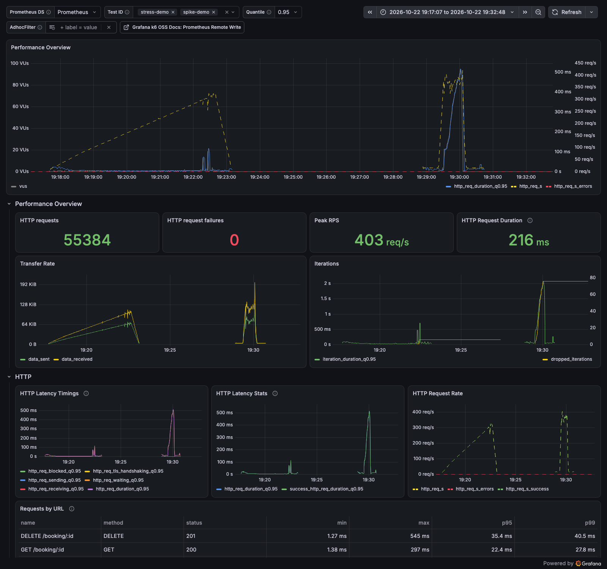
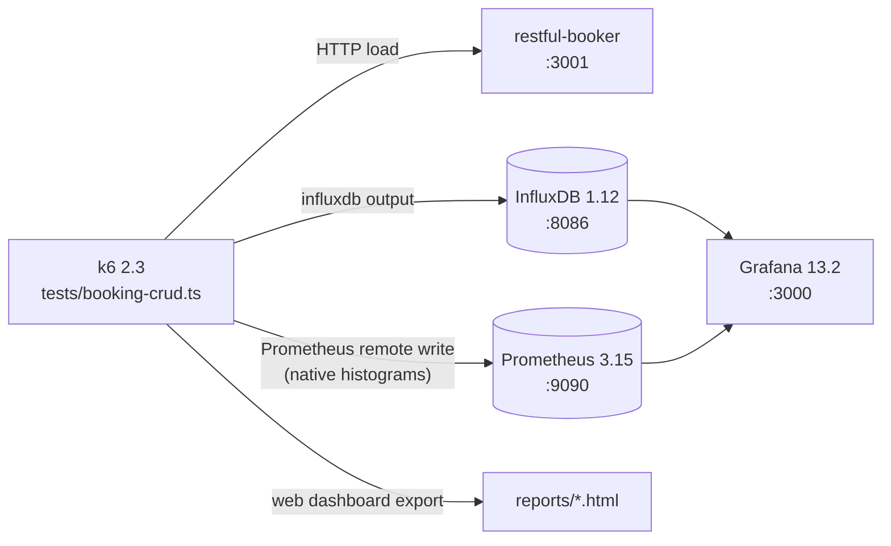
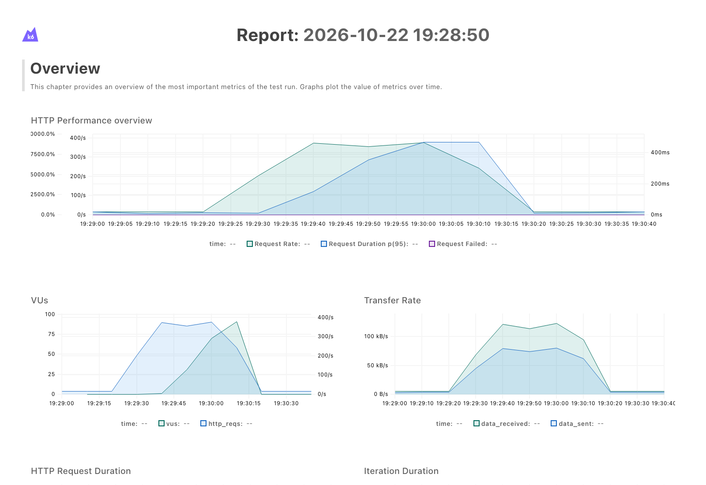
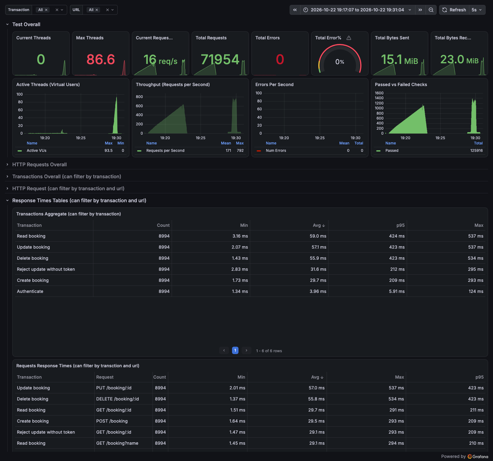

# k6 + InfluxDB + Prometheus + Grafana

[](https://github.com/easythod/k6-influxdb-grafana/actions/workflows/k6.yml)


A self-contained performance testing setup. One command starts a system under test and an observability stack,
another runs a [k6](https://grafana.com/docs/k6/latest/) test written in TypeScript. Metrics are streamed to
**InfluxDB and Prometheus at the same time**, so the two most common k6 backends can be compared side by side
on ready-made Grafana dashboards.



## What this project shows

- **API load test in TypeScript** for the full booking flow of [restful-booker](https://restful-booker.herokuapp.com/apidoc/index.html):
  authenticate → create → read and search → update → reject an update without a token → delete.
- **Four load profiles** (smoke, load, stress, spike) selected with one variable, built on arrival-rate executors.
- **Thresholds as a quality gate**: latency percentiles, error rate and check rate. A breach fails the run with exit code 99
  and fails CI. The run aborts early if more than 10% of requests fail.
- **Correct error accounting**: the negative case (`PATCH` without a token → `403`) is marked as an expected status,
  so it is checked but never counted in `http_req_failed`.
- **Low-cardinality metrics**: URLs with ids are grouped under a fixed `name` tag (`PUT /booking/:id`), so every booking
  doesn't create its own time series.
- **Two metric backends**: InfluxDB 1.x (built-in `influxdb` output) and Prometheus with native histograms
  (built-in `experimental-prometheus-rw` output), both provisioned in Grafana with dashboards.
- **Reproducible environment**: pinned image versions, health checks, a local copy of the system under test.
  Load never hits a shared public service.
- **CI on GitHub Actions**: type check, stack start-up, smoke test, a check that metrics reached both backends
  and that the dashboards were provisioned, and the k6 HTML report as a build artifact.

## Architecture



| Component | Version | Port | Role |
|---|---|---|---|
| [k6](https://github.com/grafana/k6) | 2.3.0 | 5665 (live dashboard while a test runs) | Load generator |
| [restful-booker](https://github.com/mwinteringham/restful-booker) | commit `0046115` | 3001 | System under test |
| [InfluxDB](https://docs.influxdata.com/influxdb/v1/) | 1.12.4 | 8086 | Metrics storage, InfluxQL |
| [Prometheus](https://prometheus.io/) | 3.15.1 | 9090 | Metrics storage, PromQL, remote write receiver |
| [Grafana](https://grafana.com/) | 13.2.4 | 3000 | Dashboards |

All ports are bound to `127.0.0.1`.

## Requirements

- [Docker Desktop](https://www.docker.com/products/docker-desktop/) (or Docker Engine with the Compose v2 plugin)
- `make` (preinstalled on macOS and Linux)
- Node.js 22+ only if you want type checking and editor autocompletion (`npm install`)

### Platforms: build from source or use the prebuilt image

The published restful-booker image exists for `linux/amd64` only. By default the stack builds it from source
at a pinned commit, so the image is native for your machine: `arm64` on Apple Silicon, `amd64` on Intel,
Linux, Windows and in CI. The first `make up` takes about a minute longer because of the build.

| Variant | Command | Image | Apple Silicon | Intel / Linux / Windows / CI |
|---|---|---|---|---|
| **Build from source** (default) | `make up` | `restful-booker:local`, built locally | native `arm64` | native `amd64` |
| Prebuilt image | `make up PREBUILT=1` | `mwinteringham/restfulbooker:latest` | `amd64` under emulation | native `amd64` |

Pass `PREBUILT=1` to every `make` command of the session (`make smoke PREBUILT=1`, `make down PREBUILT=1`), or
use `docker compose -f docker-compose.yml -f compose.prebuilt.yml ...` directly.

> With the prebuilt image on Apple Silicon, turn on *Settings → General → Use Rosetta for x86_64/amd64 emulation*
> in Docker Desktop. Emulation makes the system under test slower, so latency numbers are higher.

## Quick start

```sh
make up        # start restful-booker, InfluxDB, Prometheus and Grafana
make smoke     # 30-second smoke test
```

Then open Grafana at <http://localhost:3000>. Viewing needs no login; sign in as `admin` / `admin` to save changes.
The dashboards are in the `prometheus` and `influxdb` folders.
Every run also writes a standalone HTML report to `reports/`.

Without `make`:

```sh
docker compose up -d --wait
docker compose run --rm -e PROFILE=smoke k6 run \
  --tag testid=my-run \
  -o influxdb=http://influxdb:8086/k6 \
  -o experimental-prometheus-rw \
  /tests/booking-crud.ts
```

## Running tests

```sh
make smoke                    # does the flow work at all?
make load                     # expected production load
make stress                   # where does it start to degrade?
make spike                    # does it survive and recover from a sudden burst?
make test PROFILE=load OUT=prometheus   # send metrics to one backend only (influxdb | prometheus | both)
make help                     # all commands
```

| Profile | Executor | Load shape | Duration |
|---|---|---|---|
| `smoke` | `constant-arrival-rate` | 1 iteration/s | 30 s |
| `load` | `ramping-arrival-rate` | ramp to 10 it/s, hold | 4.5 min |
| `stress` | `ramping-arrival-rate` | 20 → 40 → 60 it/s | 5.5 min |
| `spike` | `ramping-arrival-rate` | 2 → 50 it/s in 10 s, back to 2 | 2 min |

One iteration is the full booking flow: 8 HTTP requests and 14 checks.

Each run is tagged with a `testid` (`<profile>-<timestamp>` by default). In the Prometheus dashboard you can pick one
or several runs in the *Test ID* selector and compare them.

### Thresholds

| Metric | Threshold |
|---|---|
| `http_req_failed` | `rate < 1%` |
| `http_req_duration` | `p(95) < 500 ms`, `p(99) < 1000 ms` |
| `http_req_duration{name:POST /booking}` | `p(95) < 600 ms` |
| `checks` | `rate > 99%` |
| `http_req_failed{scenario:<profile>}` | `rate < 10%`, aborts the run |

Configuration is read from environment variables: `BASE_URL`, `API_USERNAME`, `API_PASSWORD`, `PROFILE`.

### Example results

Measured on a MacBook (Apple Silicon) with the prebuilt amd64 image under emulation, so absolute numbers are
pessimistic:

| Run | Peak load | p50 | p95 | Errors | Dropped iterations | Verdict |
|---|---|---|---|---|---|---|
| smoke | 1 it/s | 7 ms | 22 ms | 0% | 0 | pass |
| stress, ramp to 40 it/s | ~330 req/s | 2.7 ms | 5.7 ms | 0% | 6 | pass |
| stress, ramp to 60 it/s | ~420 req/s | 3.2 ms | 621 ms | 0% | 556 | **fail**: `p(95)<500`, `p(99)<1000` |
| spike (2 → 50 it/s in 10 s) | ~400 req/s | 65 ms | 430–730 ms | 0% | 76–141 | borderline, failed `p(95)<500` once |

The service handles a gradual ramp up to about 330 req/s and saturates around 400 req/s: the p95 jumps
from single-digit milliseconds to over half a second, all 200 VUs are busy, and k6 can no longer start
iterations on schedule (`dropped_iterations`). A sudden burst hurts more than the same load reached gradually:
during the spike the median latency grows about 25×. The service never returns errors, though: requests queue
up instead of failing. This is visible in
both dashboards above (the second peak) and in the HTML report k6 writes for every run:



## Dashboards

Both dashboards come from grafana.com and are adapted for file provisioning by
[tools/prepare-dashboards.py](tools/prepare-dashboards.py).

| Dashboard | Source | Changes |
|---|---|---|
| k6 Load Test Results (Prometheus) | [18030](https://grafana.com/grafana/dashboards/18030), official dashboard by the k6 team for native histograms | Quantile selector instead of a free-text box; failure counters show `0` instead of *No data* |
| k6 Load Test Results (InfluxDB) | [23401](https://grafana.com/grafana/dashboards/23401) | Browser Web Vitals panels removed (API test); panel intervals fixed for Grafana 12+; broken variable reference fixed |

The InfluxDB dashboard breaks results down by transaction (k6 `group`) and by request (`name` tag):



### InfluxDB or Prometheus?

| | InfluxDB 1.x | Prometheus |
|---|---|---|
| k6 output | `influxdb`, every sample is stored | `experimental-prometheus-rw`, metrics are aggregated before sending |
| Percentiles | exact, computed from raw samples at query time | native histograms, a close approximation that aggregates correctly across runs and instances |
| Storage | grows with the number of requests | grows with the number of series, not requests |
| Fits best | detailed analysis of one test run | long-term trends and the same stack that monitors production |

## Project structure

```text
.
├── .github/workflows/k6.yml     # CI: type check + smoke test + metric checks
├── config/
│   ├── grafana/
│   │   ├── dashboards/          # provisioned dashboards, one folder per backend
│   │   └── provisioning/        # datasources and dashboard provider
│   └── prometheus/prometheus.yml
├── tests/
│   ├── booking-crud.ts          # test scenario
│   └── lib/
│       ├── booking-api.ts       # API client with tagging and expected statuses
│       ├── config.ts            # environment, load profiles, thresholds
│       └── data.ts              # test data generator
├── tools/prepare-dashboards.py  # downloads and adapts the grafana.com dashboards
├── docker-compose.yml           # the whole stack; builds restful-booker from source
├── compose.prebuilt.yml         # optional override: prebuilt amd64 restful-booker image
├── Makefile
└── reports/                     # k6 HTML reports (git-ignored)
```

## Stopping

```sh
make down    # stop, keep results
make clean   # stop and delete all stored results and reports
```

## License

MIT, see [LICENSE](LICENSE).
